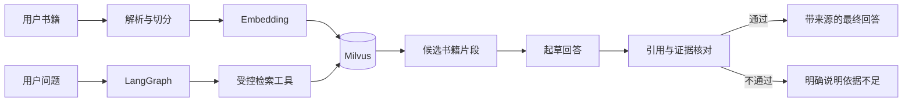
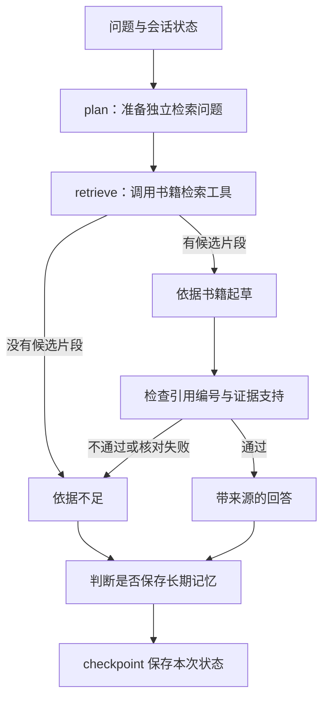

# 项目一学习与面试手册：从想法到可运行的 LLM Learning Assistant

> 本手册以当前代码为准，重点讲**问题、决策、数据流、取舍和验证**。它把开发过程整理为便于学习的建设顺序；这个顺序不是每一次历史提交的逐日记录。运行命令见项目根目录的 `README.md`。

## 先用一分钟建立全局认识

项目一是一个面向**大模型工程知识**的书籍学习助手。用户注册后，可以导入自己有权使用的 LLM 相关 PDF、Markdown 或 TXT，在聊天页提问。系统从该用户已完成索引的书籍中检索相关片段，用片段起草答案，再检查引用与证据是否匹配；依据不够就明确拒答。PostgreSQL 保存用户、会话和 LangGraph 状态，Milvus 保存书籍片段向量。简易 React 前端只负责操作与展示。

**面试时不要把它说成“全自动通用 Agent”。**当前图中有受控的书籍检索工具，但工具调用由工作流安排，不是模型任意挑选和执行外部操作。项目的核心是**垂直领域 RAG、LangGraph 状态流、可追溯引用、回答核对与评测**。



## 一、从 0 到现在：先解决什么，再解决什么

### 1. 先确定问题边界

“做一个聊天机器人”范围太大，也无法证明回答来自用户指定资料。项目把领域缩到**LLM 工程知识**，语料由用户选择的相关书籍构成。这个边界决定了后面的选择：需要上传与解析书籍，需要向量检索，需要来源页码，需要无依据时拒答，也需要用领域问题评测。

这里的“垂直领域”指知识范围和服务对象被限定，并不代表模型经过领域微调。当前领域能力主要由**用户书籍 + RAG**提供。

### 2. 先建立用户身份和数据归属

如果没有用户身份，就无法回答“这本书属于谁”“谁能看这段会话历史”。因此先做注册、登录、密码哈希、JWT，以及会话和书籍的用户归属检查。界面只有 `/login` 与 `/chat` 两个页面；书籍管理在聊天页弹窗中完成。前端不承担安全判定，后端每次收到令牌都验证身份。

### 3. 再让对话有连续状态

只调用一次模型，无法稳定地恢复多轮消息。项目用 PostgreSQL 的会话表管理侧栏列表，并给每个会话分配独立的 LangGraph `thread_id`；checkpoint 按这个标识保存图状态与消息。长期记忆则由 LangGraph Store 单独保存用户较稳定的信息。这样“同一会话的上下文”和“跨会话的用户记忆”有了不同边界。

### 4. 接上书籍知识库

用户从前端上传书籍。后端保留原文件与导入记录，在后台完成解析、切分、Embedding 和 Milvus 入库；成功后才把书籍标为 `ready`。问答时只搜索当前用户的 `ready` 书籍，并把书名、页码或段号带回回答。原文件使失败重试成为可能。

### 5. 从“能回答”走向“有依据地回答”

最初的简单方案可以直接把相似片段交给模型，但“相似”不等于“支持结论”。当前版本把所有聊天输入都送入书籍检索路径；没有片段就拒答，有片段则先起草，再做引用格式检查与一次独立的模型证据核对。核对失败时只发布依据不足的答复。用户长期记忆不作为书籍证据注入回答。

### 6. 用数据检验，而不是凭演示印象

项目同时保留检索层和最终回答层的评测。检索层看是否找得到相关片段、是否误命中；回答层看引用、关键事实短语和最终弃答。两个指标回答不同问题，不能混为一个“准确率”。

### 可以核对的版本节点

Git 当前记录从一个已具备书籍 RAG 和评测的项目快照开始：`fcdddf8`。其后 `e40e9ba` 稳定 Milvus 存储，`34f501d` 加入学习文档，`b9cd44f` 改为回答前做证据核对，`73cf369` 分开报告检索层与回答层弃答。更早的探索过程不在这些提交里，因此面试可讲**设计演进**，不要伪称每一个阶段都有对应的历史提交。

## 二、系统有哪些东西，各自负责什么

| 部分 | 当前技术 | 责任与选择理由 |
| --- | --- | --- |
| 可视化操作层 | React、TypeScript、Vite、普通 CSS | 登录、会话、输入、展示回答和书籍状态；保持轻量。 |
| HTTP 服务 | Python、FastAPI | 请求校验、鉴权、上传、会话接口、SSE 响应。 |
| 对话流程 | LangGraph、LangChain | 表示检索、无证据、起草、核对和记忆更新的状态流。 |
| 关系与状态数据 | PostgreSQL、SQLModel / SQLAlchemy、LangGraph Postgres checkpoint / Store | 用户、会话、书籍元数据、图状态、长期记忆。 |
| 原文件 | 本地 `backend/data/books` | 保存上传内容，支持解析、重试与删除。 |
| 向量检索 | Milvus Standalone、Docker 命名卷 | 存储书籍片段向量、文本及来源字段；按用户和书籍过滤。 |
| 文档处理 | pypdf、文本切分器 | PDF 提取页文字；Markdown/TXT 解码；分段并保留位置。 |
| 模型服务 | 硅基流动接口、当前配置的 `BAAI/bge-m3` 与聊天模型 | 生成 1024 维 Embedding、改写问题、起草与核对回答。 |
| 认证与验证 | JWT、密码哈希、pytest、离线与真实链路评测 | 控制访问并验证关键行为。 |

这些组件分工的关键是：**PostgreSQL 是结构化记录与状态的来源，Milvus 是语义检索的索引，本地文件是可重新解析的原件。**书籍知识库不等于用户长期记忆。当前长期记忆会保存，但不会被当作书籍事实加入严格 RAG 回答。改换 Embedding 模型或维度，需要新集合并重建索引，不能让新旧向量混用。

## 三、按一次真实操作理解数据流

### 1. 用户注册、登录

注册请求包含用户名、邮箱和密码。后端检查输入和重复值，保存密码哈希，不保存明文；注册成功直接返回 JWT。登录可用用户名或邮箱。前端把令牌存到浏览器 `localStorage`，后续请求放进 `Authorization: Bearer ...`。后端校验签名、期限，并查用户是否存在。当前令牌默认有效期为 120 分钟。

开发环境中，Vite 在 `localhost:5173` 提供页面，并把 `/api` 请求代理到 FastAPI 的 `127.0.0.1:8000`。因此页面能打开只证明前端可用；此前遇到的 `ECONNREFUSED 127.0.0.1:8000`，是代理找不到后端的连接问题，不是注册业务规则报错。

### 2. 创建会话、再次进入会话

用户点击“新建对话”并发送第一条消息，前端先创建会话。PostgreSQL 中的 `conversation_id` 供列表展示和权限检查；相应的 `thread_id` 供 LangGraph checkpoint 恢复消息。每次聊天，后端先确认会话属于当前用户，再把 `thread_id` 交给图。返回聊天页时，侧栏读会话表，历史消息读 checkpoint。

```text
浏览器 conversation_id → 后端核验所有者 → 找到 thread_id → 恢复 LangGraph 状态
```

这解释了为什么不能只把聊天历史存在前端：刷新、换浏览器、服务重启时，浏览器状态都不可靠；真正的历史需要由后端持久化。

### 3. 用户导入一本书

前端上传 PDF、Markdown 或 UTF-8 TXT。后端限制单文件 25 MB，检查是否为空、扩展名是否支持，并用 SHA-256 防止同一用户重复导入完全相同的文件。原文件写入用户目录，PostgreSQL 中先创建 `processing` 记录；HTTP 请求先返回，FastAPI 后台任务再处理。前端轮询看到 `processing → ready` 或 `failed`。

后台任务按这个顺序执行：

1. **解析**：PDF 按页抽取文字；文本文件按 UTF-8 解码。扫描件没有可抽取文字时失败，当前没有 OCR。
2. **切分**：约 800 字符一段，重叠 120 字符，降低知识点恰好跨段造成的信息损失；保留 PDF 页码或文本段号。单书最多 4000 段。
3. **向量化**：分批调用 Embedding 服务，把片段映射到统一向量空间。
4. **索引**：向 Milvus 写入向量，以及 `user_id`、`book_id`、书名、位置和文本。成功后书籍才是 `ready`。

如果处理失败，记录错误并尝试清理该书的向量；用户可以在前端重试。服务重启时残留的 `processing` 会标记为失败，避免界面永久显示“处理中”。这里使用的是依附于 Web 进程的后台任务，**不是**可跨进程恢复的持久任务队列；大批量导入时需要升级这一部分。

### 4. 用户提出一个知识问题

以“Checkpoint 有什么作用？”为例：



`plan` 对明显的领域词直接使用原问题；对“那它有什么作用”这类需要上下文的问题，可让模型改写成独立检索问题。即便改写失败，也使用原问题继续检索，**不会直接让模型凭自身知识回答**。

`retrieve` 先在 PostgreSQL 获取该用户所有 `ready` 书籍 ID，再把问题向量化，在 Milvus 中同时按用户和书籍 ID 过滤，最多取 5 个候选片段；相似度低于当前阈值 0.55 的片段被过滤。这里的相似度表示主题接近，不是答案正确概率。

若没有候选片段，直接返回“当前知识库没有足够依据”。若有片段，模型收到编号、书名、页码和正文，起草带 `[1]`、`[2]` 等编号的回答。系统先检查编号是否有效，再让模型以核对员身份判断：每个事实性结论是否**由所引片段直接支持**。缺少引用、核对不通过或核对调用失败，都返回统一的依据不足答复，且不附来源。最终回答之后才判断用户话语是否值得存为长期记忆。

**边界必须讲清楚：**第二次核对仍是模型判断，可能误判；它降低风险，不能证明“绝对零幻觉”。书籍本身可能有错误，PDF 提取可能有乱码，引用编号有效也不等于引用必然支持所有句子。

### 5. 回答为什么仍使用 SSE

前端请求 `/chat/stream`。当前后端先等整条图完成，包括证据核对，**不会把未经核对的草稿发给浏览器**。之后把最终回答拆成若干 SSE `token` 事件，再发送 `sources` 和 `done`。因此界面仍分段展示，但首段可能等得更久；这是“先核对再公开”的取舍，不应在面试中称为模型原始 token 的实时透传。前端等待时显示“检索并核对书籍依据中…”。

## 四、为什么这样分层

后端大致沿着“接口 → 服务 → 仓储 / RAG 组件 → 基础设施”组织。接口层处理 HTTP、身份和错误码；服务层决定业务顺序，例如先保存文件再处理索引；仓储层管理 PostgreSQL；RAG 组件拆成解析、Embedding、Milvus 存取与核对；LangGraph 管聊天节点的顺序和分支。

分层价值在于**错误可定位、能力可替换、测试能聚焦**。例如上传失败先问解析、Embedding 还是 Milvus 出错；引用不可靠则分辨是检索片段不对，还是生成与核对失效。前端无须知道向量库的细节，Milvus 也不负责用户密码或会话列表。

项目没有把一切都抽象成复杂框架。当前导入量不大，FastAPI 后台任务足以展示完整业务链；当前工具只有书籍检索，图的显式节点比开放式自动工具代理更便于约束和审查。

## 五、评测要会解释，尤其是两个“弃答率”

| 问题 | 指标 | 当前小样本结果 | 它不能证明什么 |
| --- | --- | --- | --- |
| 能否找回已标注的书籍页？ | Hit@5、MRR | 10 道正例 Hit@5 = 1.00，MRR = 0.6533 | 不证明引用内容支持最终答案。 |
| 无依据问题会不会误检到相似片段？ | **检索层**弃答 | 5 道中 3 道没有片段，即 3/5 | 不等于最终回答错误 2/5。 |
| 用户最终是否看到无依据的回答？ | **回答层**弃答 | 同组 5 道均拒答且无来源，即 5/5 | 样本太小，不能保证所有问题。 |
| 正例回答是否覆盖标注短语、引用有效并命中相关书籍？ | 回答格式与短语指标 | 5 道样例均为 1.00 | 不等于“事实正确率 100%”。 |

为什么保留检索层 3/5？它是**内部诊断**：说明两道题找到了“主题相关但证据不足”的片段；如果以后新增书籍、改切分或调阈值，这个数和逐题结果会帮助定位退化。面试展示应优先说明用户最终看到的 5/5，再解释检索层的误命中如何被核对节点拦住。不要把 5/5 说成全系统的无幻觉准确率。

也不能简单把 0.55 阈值调高来换一个漂亮的检索弃答率。现有某道真正有依据的正例最高相似度约为 0.6167；把阈值提高到 0.62，可能连它也过滤掉。评测集需要同时包含正例、难负例和跨书问题，观察召回与误命中的权衡。当前书籍数量和具体指标是一次本地快照，用户继续上传资料后应重测。

## 六、面试时怎么讲

### 30 秒版本

> 我做的是一个 LLM 工程知识学习助手。用户能上传自己的相关书籍，系统解析并向量化后存入 Milvus。提问时 LangGraph 调用书籍检索工具，只从当前用户已就绪的资料中取片段；回答需要引用和证据核对，否则明确拒答。PostgreSQL 保存用户、会话、图状态和长期记忆。我还用正反例分别评测检索与最终回答，避免只看演示效果。

### 约 2 分钟版本的讲述顺序

1. **问题**：通用模型能回答，却难证明答案来自用户指定书籍；求职项目需要展示可追溯、可评测的工程链路。
2. **架构**：简易 React 界面、FastAPI 接口、PostgreSQL 关系与图状态、Milvus 向量检索、LangGraph 控制聊天流程。
3. **导入**：前端上传 → 原文件和元数据 → 解析、切分、Embedding → 向量索引 → `ready`；失败可重试。
4. **问答**：校验用户与会话 → 检索用户的已就绪书籍 → 起草带编号答案 → 核对证据 → 通过才发送。
5. **效果与局限**：说出小样本的检索误命中和最终拒答结果；承认二次模型核对、PDF 提取与评测规模的边界。

这个顺序让面试官先明白**问题和你做出的设计判断**，再听技术名词。

## 七、常见追问与建议回答

### 1. 为什么选 RAG，不直接让大模型回答？

因为目标是根据用户指定的书籍回答，并展示来源。RAG 让问题先找证据，再让模型组织语言；也便于在没有证据时拒答。它仍不能自动保证事实正确，所以增加引用核对和人工评测。

### 2. 为什么选 Milvus，PostgreSQL 已经有了？

项目希望把关系数据和向量检索职责分开：PostgreSQL 管用户、会话、状态，Milvus 管片段向量搜索。Milvus 是本项目明确选择的向量库；这里没有使用 pgvector。选择的代价是多一个 Docker 服务，以及数据一致性与备份要分别处理。

### 3. 为什么原文件、书籍记录、向量要存三份？

原文件是可重新解析的输入；PostgreSQL 记录归属、状态、哈希和路径；Milvus 是检索索引。若索引失败，可用原文件重试；若书籍未 `ready`，检索不会使用它。三者各自服务不同问题。

### 4. 为什么切分，还要有重叠？

整本书过长，无法有效地作为一次检索单位。按段切分能把相近内容找出来；重叠减少定义或论证刚好跨段时的断裂。片段过短丢上下文，过长则混入无关内容；当前 800/120 是初始工程参数，需要靠评测继续调整。

### 5. 为什么导入时和提问时都要调用 Embedding？

书籍片段先变为向量，问题也必须进入**同一个向量空间**，两者才能按语义距离比较。如果更换模型或维度，旧向量与新问题不再可比，需要重建索引。

### 6. 为什么还需要 LangGraph？普通函数调用不行吗？

当前流程用普通函数也能实现，但 LangGraph 使“准备问题 → 检索 → 有无证据分支 → 起草核对 → 记忆更新”成为显式状态流，并能按 `thread_id` checkpoint 恢复多轮状态。它展示了受控、可扩展的工作流；我不会声称当前图复杂到只能由 LangGraph 实现。

### 7. 这项目真的调用了工具吗？是自主 Agent 吗？

调用了一个定义明确的书籍检索工具，图中的 `retrieve` 节点负责调用。模型并没有自由决定调用浏览器、数据库写入或其他业务工具。因此我称它为“带受控工具调用的 LangGraph 学习助手”，而非开放式自主 Agent。

### 8. 为什么会话 ID 和 thread ID 分开？

会话 ID 适合关系表与前端列表，也用于权限检查；thread ID 是 LangGraph checkpoint 的键。后端把二者关联，先检查会话归属，再恢复对应图状态。这样 UI 数据与图状态各有清晰职责。

### 9. 书籍知识库和长期记忆有什么区别？

书籍是领域事实来源，有书名和位置，可引用；长期记忆是用户学习目标、偏好等个人上下文。当前严格 RAG 回答不把长期记忆当书籍证据。两类数据不能混在一起，否则很难解释答案依据。

### 10. 既然检索出来了，为什么还要核对？

向量相似度只说明主题接近。例如问“Agent 工具如何人工审批”，可能找到讲 Agent 工具调用的片段，但片段未必说明审批机制。核对节点检查回答是否由**所引片段**支持，挡住了这类已观察到的误命中。

### 11. 能保证零幻觉吗？

不能。程序能强制“无候选片段就拒答”和“无有效引用就拒答”；证据充分性仍依赖另一次模型判断，可能误判。书籍也可能有错。我的做法是缩小风险、展示引用、构建负例评测，并明确保留人工复核。

### 12. 为什么检索弃答只有 3/5，最后回答却是 5/5？

前者只看有没有候选片段，后者看完整流程最后是否拒答。两道负例在检索时误命中，但后续核对没有让无依据答案发给用户。这恰好说明分层评测能定位问题；5/5 只针对当前五题，不代表普遍准确率。

### 13. SSE 是真正的模型实时输出吗？

当前不是。为避免草稿先泄露，后端等生成和核对全部结束后，把最终文本拆成 SSE 事件发送。用户仍看到分段显示，但首段延迟会增加。这是可信度优先于即时首字体验的取舍。

### 14. 上传处理为什么放后台？失败后怎么办？

解析和 Embedding 可能要数秒甚至更久，同步等待会使上传接口迟迟不返回。后台任务让前端先看到 `processing`，再轮询状态。失败会记录原因、尝试清理向量，用户可重试；服务重启中断也会标记失败。当前没有独立持久队列，这是规模化时要升级的地方。

### 15. 多用户怎么隔离？

HTTP 请求先通过 JWT 得到用户；会话、书籍操作检查所有者。检索时既从 PostgreSQL 列出该用户的 `ready` 书籍，又在 Milvus 查询中过滤 `user_id` 和书籍 ID。前端隐藏其他用户内容不是安全措施，后端检查才是。

### 16. 你最想继续改进哪里？

优先扩充人工标注的正例、难负例和跨书问题，按错误发生层次分析。其次根据结果考虑重排或更可靠的证据判别；对于扫描版 PDF 加 OCR；导入量大时换持久任务队列。不会为了堆技术名词就增加无关页面或工具。

## 八、如何自己演示并真正学会

按因果顺序做一遍，比背文件名更有效：

1. 按 `README.md` 启动 PostgreSQL、Milvus、后端和前端；检查 `/health`、`/health/db`、`/health/milvus`。如果 Vite 报 `ECONNREFUSED`，先确认 8000 端口上的后端。
2. 注册一个演示用户，看 `/login` 如何进入 `/chat`；解释令牌和后端鉴权各做什么。
3. 从“知识库”上传项目自编的 `backend/evals/demo_corpus.md`，观察 `processing → ready`；再用不支持的格式或扫描件思考失败路径。
4. 问一个文件里能找到的问题，检查答案编号、书名和段号；问一个没有依据的问题，看标准拒答。
5. 切换会话并刷新页面，解释会话表与 checkpoint 各保存什么。
6. 运行检索与回答评测，打开逐题结果，亲自找出误命中，不要只记总分。

讲解时可沿着这条线复述：**输入是什么 → 写到了哪里 → 哪个环节作决定 → 怎样防止错误进入下一环节 → 用什么证据证明有效**。

## 九、当前真实边界，面试时主动讲出来

- 书籍原文不随代码分发；换环境需导入有权使用的资料并重建向量索引。
- PDF 依赖文字提取；扫描版需外部 OCR，部分排版可能提取质量差。
- 使用 FastAPI 后台任务处理导入，尚无持久任务队列。
- 固定相似度阈值与小样本评测不足以覆盖新书籍、新问法；需要持续补难例。
- 引用编号校验是确定性的，证据充分性核对仍由模型完成，可能犯错。
- 当前 SSE 是**核对后分段发送最终答案**，并非模型实时 token；等待时间比直接流式生成更长。
- 当前图有受控检索工具和长期记忆保存，但没有开放式多工具规划或业务动作执行。

如果能够把这些局限和对应的改进优先级讲清楚，项目介绍会比单纯罗列 LangChain、LangGraph、Milvus 更可信。
