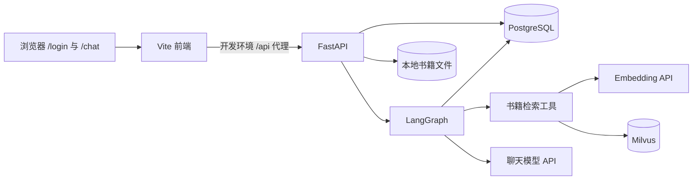
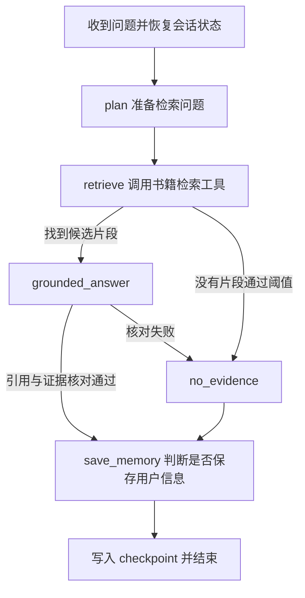

# 项目一：LLM Learning Assistant 运行原理与设计思路

> 阅读目标：不背代码，能解释“为什么要这样做”“一个请求经过哪些环节”“每个环节失败时会发生什么”。本文依据当前项目实现编写。下文的“从 0 到现在”是理解项目的**设计演进顺序**，不是逐次提交记录。

## 1. 先给项目一句准确的定义

这是一个面向**大模型工程知识**的学习助手。用户可以注册、登录、上传自己有权使用的 LLM 相关书籍，然后围绕 LangChain、LangGraph、RAG、Agent、模型训练与部署等主题提问。每个问题都先检索用户自己的书籍；只有候选回答通过引用格式和证据核对，才会交给用户。会话与长期记忆可以跨请求保存。

它不是“把 PDF 丢给模型”的单次聊天，也不是开放式自动执行任意动作的通用 Agent。当前图中有一个受控工具：**书籍检索**。前端是操作入口，工程重点在后端的状态、检索、证据约束和评测。

可以先记住这一条主线：

```text
书籍 → 解析 → 切分 → 向量化 → Milvus
                         ↑
用户问题 → 改写检索问题 → 检索证据 → 生成候选回答 → 核对引用与证据 → 发布回答
                                  ↘ 无依据或核对失败 → 明确拒答
```

## 2. 为什么从 0 开始要按这个顺序建设

### 阶段一：先让一个人能进入系统并拥有自己的会话

没有用户身份，书籍和历史就不知道属于谁；没有会话标识，多轮对话也无法稳定续接。因此先建立注册、登录、用户归属和会话列表。注册时验证用户名、邮箱和密码，密码只保存哈希；登录成功后签发有有效期的 JWT。后续请求带上令牌，后端再取出用户身份。

这里的核心问题不是“页面长什么样”，而是**任何数据操作都必须有明确的所有者**。同一个会话 ID 或书籍 ID，不能让别的用户仅凭猜到编号就访问。

### 阶段二：让聊天成为可持续的工作流

单次调用模型只能回答当前输入。学习助手需要多轮上下文，也可能在回答前做判断、检索，在回答后保存值得记住的信息。于是使用 LangGraph 把一次聊天拆为有先后关系的节点，并以 `thread_id` 保存图状态。

### 阶段三：让领域回答有可追溯的依据

只用模型自身知识，回答很难说明来自哪本书、哪一页，也可能与用户指定资料不一致。于是增加书籍导入与 RAG：把文本拆成片段并向量化，提问时按语义相似度取回片段，再让模型只依据片段回答。

### 阶段四：用评测替代“感觉效果不错”

能返回答案不代表检索正确，能附上引用也不代表引用支持结论。因此项目加入人工标注的问题集，分别检查检索命中、排序、无依据问题的弃答，以及回答中的关键事实短语和引用格式。小样本只能作为回归基线，不能证明所有场景都可靠。

这四个阶段分别回答了四个工程问题：**谁在用、如何延续、依据是什么、如何证明有效**。

## 3. 一张图看清运行中的系统



各组件的职责要分清：

| 组件 | 管什么 | 为什么不能随便互换 |
| --- | --- | --- |
| React + Vite | 表单、会话列表、聊天显示、书籍管理入口 | 只负责交互，不决定检索或回答逻辑。 |
| FastAPI | 接口、鉴权、协调服务、SSE 输出 | 所有用户归属检查从这里进入。 |
| PostgreSQL | 用户、会话、书籍记录、LangGraph checkpoint 和长期记忆 | 这些是结构化关系与持久状态。 |
| 本地文件目录 | 上传的书籍原文件 | 失败后可重试解析与索引；数据库只记文件路径和元数据。 |
| Milvus | 书籍片段的向量、文本和来源字段 | 用语义相似度找到可能相关的片段。 |
| Embedding 模型 | 把书籍片段和问题变成同一向量空间的数字表示 | 导入和查询必须使用兼容的模型与维度。 |
| 聊天模型 | 改写检索问题、依据片段起草回答、核对证据、长期记忆判断 | 模型自身知识不应成为书籍回答的依据。 |

**容易混淆的一点：**长期记忆与书籍知识库不是同一份数据。长期记忆记录“这个用户的稳定学习目标或偏好”；书籍知识库存“用户上传的专业资料”。前者通过 LangGraph Store 放在 PostgreSQL，后者的可检索片段放在 Milvus。

### 后端分层是为了解决什么问题

后端大致按“接口层 → 服务层 → 仓储层 / RAG 组件 → 基础设施”组织。接口层接收请求、做鉴权并返回 HTTP 响应；服务层安排业务顺序，例如上传后先保存原文件和书籍记录，再安排索引；仓储层负责读取和更新 PostgreSQL；RAG 组件分别负责解析、向量化和 Milvus 存取；基础设施负责数据库连接与配置。LangGraph 则负责聊天时的**决策顺序**，调用服务与工具完成节点工作。

这样分层的目的不是让文件夹看起来整齐，而是让问题能定位：注册失败先看鉴权与用户服务，导入失败按解析、Embedding、Milvus 的顺序排查，回答没有引用先看图的路由和检索结果。评测也可以分别覆盖检索、回答，而不必每次从浏览器测起。

## 4. 从打开网页到成功登录

浏览器打开 `/login`。登录和注册在同一页面切换；注册请求提交用户名、邮箱、密码，后端检查格式与重复值，将密码哈希写入 PostgreSQL，然后直接返回 JWT，所以注册成功后不用再登录一次。登录可使用用户名或邮箱，后端验证密码哈希后返回同类令牌。

前端把令牌存在浏览器的 `localStorage`。之后请求在 `Authorization: Bearer ...` 中携带它。后端验证签名和过期时间，再去数据库确认用户仍存在。前端看到令牌会进入 `/chat`；**真正的授权依据仍是每次后端验证**，而不是页面是否显示。令牌默认有效期为 120 分钟；过期后受保护接口会报 401，需要重新登录。

开发环境中，浏览器访问 Vite 的 `localhost:5173`，以 `/api` 开头的请求由 Vite 转发到 FastAPI 的 `127.0.0.1:8000`。所以“页面能打开”只证明前端启动了，不证明后端、PostgreSQL、Milvus 或模型服务都可用。此前出现的 `ECONNREFUSED 127.0.0.1:8000`，就是代理找不到后端，而非注册页面样式问题。

## 5. 会话为什么有两个标识

新建对话后，PostgreSQL 的 `conversations` 表会产生一个数值型 `id`，供界面列出和选择；同时生成一个独立的 `thread_id`，供 LangGraph checkpoint 定位该会话的状态。两者有映射关系，但用途不同。

```text
前端选择 conversation_id
      ↓
后端检查：这个会话属于当前登录用户吗？
      ↓
取出对应的 thread_id
      ↓
LangGraph 从该 thread_id 的 checkpoint 恢复消息与状态
```

因此，侧栏会话列表来自普通关系表；聊天历史则从 LangGraph 的 checkpoint 读取。回答后更新会话的 `updated_at`，使最近使用的会话排在前面。这个设计让 UI 所需的“列表信息”和工作流所需的“完整运行状态”各由适合的结构负责。

## 6. 上传一本书时，系统到底做了什么

用户在 `/chat` 右上角的“知识库”中选择 PDF、Markdown 或 TXT。前端提交文件，后端先检查扩展名、非空和 25 MB 上限，计算 SHA-256，阻止同一用户重复导入完全相同的文件。原文件写入用户专属目录，PostgreSQL 记录书名、文件路径、哈希和 `processing` 状态。接口先返回，后续解析与向量化在 FastAPI 后台任务中执行；前端定时刷新状态。

后台处理的逻辑顺序是：

1. **解析**：PDF 按页提取文字；Markdown/TXT 按 UTF-8 解码。扫描版 PDF 没有可提取文字时会失败，当前系统不做 OCR。
2. **切分**：用约 800 字符的片段和 120 字符重叠保存上下文。PDF 保留页码；文本文件记录段号。单书超过 4000 片段时要求拆分。
3. **向量化**：调用 Embedding API，把每个片段变成 1024 维向量，分批处理。
4. **入库**：将向量连同 `user_id`、`book_id`、书名、页码、文本写入 Milvus。成功后把 PostgreSQL 状态改为 `ready`，记录片段数。

这里有两个重要的顺序约束。第一，**先保留原文件**，这样失败后才有重试来源。第二，只有状态为 `ready` 的书籍才参与检索，避免用户看到导入一半的资料。失败会记录原因并尝试清理该书的向量；前端提供重试。若服务在处理中重启，启动时会把遗留的 `processing` 记录标成失败，用户可重试。

后台任务依附于当前 FastAPI 进程，并不是独立的持久任务队列。对本地作品集足够直接；若以后需要大批量并发导入，才值得引入专门的任务队列和工作进程。

## 7. 一条聊天请求经过 LangGraph 的全过程

假设用户问：“LangGraph 的 Checkpoint 有什么作用？”



**第一步：准备检索问题。**明显包含 LangGraph、RAG、Agent 等关键词的问题直接作为检索问题；其他问题可由模型结合最近对话补全省略信息。改写失败时使用原问题。无论哪种情况，当前版本都进入书籍检索路径，不再使用模型自身知识直接回答。

**第二步：检索证据。**书籍检索是图中显式定义的工具。它先从 PostgreSQL 找到当前用户所有 `ready` 书籍 ID，再把问题向量化，在 Milvus 中同时按 `user_id` 和书籍 ID 过滤，最多取回 5 个候选片段，并去掉相似度低于 `RAG_MIN_SCORE` 的片段（当前默认 0.55）。数据库的书籍状态与 Milvus 的用户过滤一起构成隔离边界。

**第三步：起草并核对。**若没有候选片段，图直接输出“当前知识库没有足够依据”，不调用回答模型编造书中内容。若有片段，图把编号、书名、位置和正文放入提示，要求模型只依据这些材料起草回答，在相关论述后标 `[1]`、`[2]`。候选回答必须有有效引用；随后再次调用模型核对每个结论是否由对应片段直接支持。缺少有效引用、核对失败或核对调用出错时，都只发布统一的依据不足答复。长期记忆不注入这个书籍回答步骤。

**第四步：保存状态。**回答结束后，图检查用户刚才的话是否包含值得长期保存的信息，例如稳定的学习目标或偏好；普通一次性问题不应进入长期记忆。然后 checkpoint 保存消息与图状态，以便下次继续。

需要理解“有候选片段”和“片段足以支持答案”不是一回事。相似度只表示主题接近，不能证明事实成立。额外的模型核对能挡住部分误答，但核对模型也可能判断错误；它不是数学意义上的无幻觉保证。重要结论仍应人工查看引用原文。

## 8. 为什么回答会逐段出现

前端对 `/chat/stream` 发起 POST 请求。FastAPI 先等待 LangGraph 完成检索、起草和核对，**不向浏览器发送未经核对的草稿**。拿到最终回答后，再把它分段包装成 SSE 事件：先是多个 `token`，随后发送 `sources`，最后发送 `done`。前端按事件边界不断追加到当前 AI 消息。发送前已检查令牌和会话归属。

因此首段文字要等核对完成，可能比原先慢；SSE 负责分段展示**已核对的最终内容**，不是实时公开模型草稿。若流中出错，后端发 `error` 事件；前端会显示失败信息。切换页面或退出时，前端会中止活动请求。刷新页面后，前端通过历史接口从 checkpoint 重新取消息，而不是依赖浏览器里暂存的那份文本。

把前面的步骤连成一次完整经历：用户登录后选择会话，后端先确认这个会话属于他；用户提出 Checkpoint 问题，图恢复该会话状态；问题被向量化，Milvus 在该用户已就绪书籍中找候选片段；回答节点根据片段起草并核对；只有通过后 SSE 才发送最终文字与来源列表，同时 checkpoint 保存会话。下一次打开这个会话，历史接口就从同一个 `thread_id` 找回刚才的问题和回答。

## 9. 如何判断它真的有效

项目目前把“检索是否找到依据”和“回答是否使用依据”分开评测。

| 层次 | 主要问题 | 当前检查 |
| --- | --- | --- |
| 检索 | 正确来源是否出现在前 K 个结果中？排序靠前吗？ | Hit@K、MRR、检索延迟。 |
| 无依据检索 | 不该回答的问题是否没有检索结果？ | 反例的检索弃答准确率。 |
| 回答 | 是否覆盖人工列出的关键短语？引用编号是否有效？是否引用了相关书籍？ | 事实短语覆盖率、引用格式、来源命中率、回答延迟。 |
| 无依据回答 | 即使检索到了相似片段，最终是否仍拒绝无依据回答？ | 回答层弃答准确率，并检查来源列表为空。 |
| 人工复核 | 引用片段是否真的支持每句话？有没有遗漏、误导或编造？ | 当前仍需人工审阅。 |

本地基线中，最初两份 PDF 的 10 道页码标注题 Hit@5 为 1.00、MRR 为 0.6533。后来增加资料；2026-09-28 的一次快照中，五份资料共有 228 个片段。5 道无依据反例的**检索层**弃答准确率为 3/5：两道题找到了主题相近、内容却不充分的片段。收紧后的完整回答链对同一组 5 道题全部明确拒答且不返回来源，因此这组样例的**回答层**弃答准确率为 5/5。展示用户实际体验时应优先说明回答层结果；保留检索层指标是为了定位误命中、观察增加书籍后的变化，而不是把它当作用户最终回答的准确率。这仍只是小样本结果。

5 道正例回答的关键短语覆盖、引用编号有效率和相关书籍命中率均为 1.00。这些分数建立在小样本、短语和格式检查上，不能读作“事实正确率 100%”。额外核对增加了回答延迟；模型服务还可能偶发较长延迟，超时和重试不能保证每次都很快。

## 10. 这是不是一个 Agent 项目

可以称为**有受控工具调用的 LangGraph 学习助手**。图有状态、书籍检索工具、依据分支、回答核对和长期记忆判断；检索工具由图调用，能够说明检索结果如何影响后续节点。

但当前它没有开放式工具规划，也不会自主调用浏览器、执行代码、审批或修改外部业务系统。求职展示时，准确表述比夸大“全自动 Agent”更有说服力：这个项目重点展示**领域 RAG + 可控工作流 + 来源引用 + 评测**。项目二的售后工单 Agent 才计划重点展示多工具、审批、幂等和业务动作。

## 11. 从启动到观察结果的学习路线

建议按“先看现象，再解释内部原因”的方式学习，而不是从第一行代码往下背。

1. **启动依赖**：PostgreSQL 保存关系数据与图状态；Docker 中的 Milvus 保存向量；后端提供接口；Vite 提供开发页面。依次检查 `/health`、`/health/db`、`/health/milvus`。启动细节与命令见项目根目录的 `README.md`。
2. **注册并提问**：观察浏览器从 `/login` 到 `/chat`；思考“令牌证明了什么”“后端为什么仍要查用户和会话归属”。
3. **上传演示资料**：可用项目自编的 `backend/evals/demo_corpus.md` 练习，观察 `processing → ready`。思考为什么接口先返回、为什么失败需要保留原文件。
4. **问一条能找到依据的问题**：看回答中的编号、书名和位置；再问一条资料没有覆盖的问题，看系统是否拒答。思考“相似”与“支持”有什么差别。
5. **重开同一会话**：观察历史还在；再新建一个会话，理解 `conversation_id` 与 `thread_id` 的分工。
6. **运行评测**：在同一用户已导入对应资料后，按 `README.md` 的命令运行检索和回答评测。阅读逐题结果，比只看总分更重要。

## 12. 排查故障时先问哪一层坏了

| 现象 | 优先检查的因果链 |
| --- | --- |
| 页面能打开，注册报连接失败 | Vite 已启动，但代理是否能连接 `127.0.0.1:8000`？后端进程是否正常启动？ |
| 后端启动失败 | PostgreSQL 连接、环境变量、依赖安装、checkpoint 初始化是否成功？ |
| 登录成功，书籍导入一直失败 | 文件是否可提取文字？Embedding API 密钥及额度是否可用？Milvus 是否健康？看书籍记录中的错误原因和后端日志。 |
| 书籍显示 `ready` 却查不到 | 是否用同一用户提问？该书是否有索引片段？问题与片段相似度是否低于阈值？ |
| 找到了片段但回答不可靠 | 先检查片段本身是否支持结论，再检查模型回答与引用，不要只调整提示词。 |
| 停止或重启后知识库丢失 | 检查 Docker 容器是否仍挂载命名卷 `llm-staudy-milvus-data`，以及 PostgreSQL 的书籍记录是否仍在。 |

## 13. 当前边界与下一步该怎样思考

当前实现适合本地演示和持续学习，仍有明确边界：扫描版 PDF 需要外部 OCR；PDF 文字提取质量取决于原文件；后台导入不是持久任务队列；相似度阈值和小型评测集不能保证严格事实正确；书籍原文不随代码分发，换一台机器必须自行导入合法资料并重新建立索引。

如果要继续提高质量，先扩大有人工标注的正例、难负例和跨书问题，再分析错误属于**解析、切分、检索、证据核对还是生成**。只有定位了错误层，才决定是否引入 OCR、重排、更强的证据判别、更多工具或任务队列。这个顺序比不断叠加框架更符合工程思维。

## 14. 用自己的话复述项目的五个问题

学完后，尝试不看代码回答：

1. 为什么只保存聊天文本不够，还要有 `conversation_id`、`thread_id` 和 checkpoint？
2. 为什么 PostgreSQL、原文件目录和 Milvus 要分别保存不同形态的数据？
3. 上传书籍为什么不能立即标记为 `ready`？失败和服务重启后如何恢复？
4. 为什么检索到相似片段仍可能需要拒答？如何从评测结果发现这一点？
5. 这个项目里的“工具”具体是什么？它与开放式自主 Agent 的区别在哪里？

如果这五个问题能讲清楚，你就掌握了项目的主干逻辑。此后读具体模块时，代码只是在实现你已经理解的数据流和决策边界。
